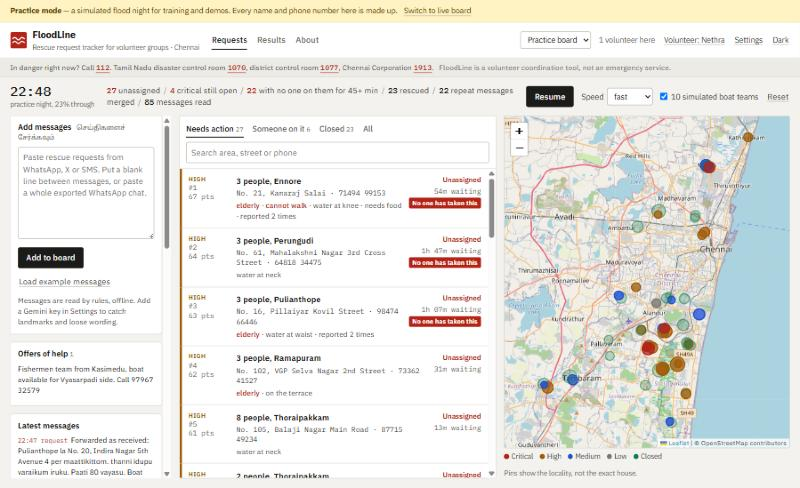
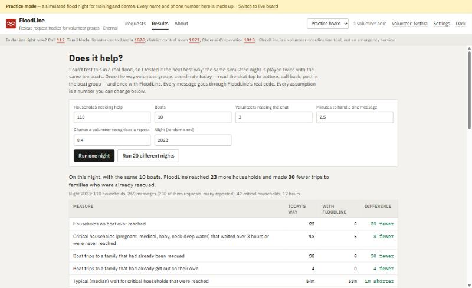

# FloodLine

A rescue request tracker for volunteer groups during Chennai floods.

Volunteers paste the rescue requests that arrive on WhatsApp, X and SMS. FloodLine reads them (English, Tamil or Tanglish), groups repeats of the same household, puts the most urgent at the top with the reasons written out, and keeps each request on the list until someone marks the family as rescued.

Live: https://nethra-r368.github.io/floodline/ — it opens on a practice board with a simulated night. Press "Start the night". Every name and phone number on the practice board is made up.



## Why

During the 2015, 2023 (Michaung), 2024 (Fengal) and 2025 (Ditwah) floods, phone lines went down and rescue requests moved to social media. Volunteer groups read them by hand and passed them to boat teams. The same problems came up each time:

- One family is posted many times by different relatives, so two boats go to the same house.
- Nobody knows which requests are already handled, so old ones keep being forwarded after the family is safe.
- A request nobody picked up scrolls out of view.

This has been tried before: in the 2018 Kerala floods, volunteers built keralarescue.in, an open-source rescue request site that the state adopted as its official one. FloodLine is a much smaller attempt at the same idea, built around how requests arrive in Chennai: forwarded WhatsApp messages, often in Tamil or Tanglish.

## What it does

- **Reads messages.** Rules pull out the area, phone numbers, number of people, water level and who is vulnerable (pregnant, needs medical care, baby, elderly, cannot walk). They work offline. With a Gemini key, Gemini re-reads each message to catch what rules miss, like landmarks ("near Phoenix mall" is Velachery) or "old couple" meaning two people.
- **Checks the AI.** Anything Gemini returns that isn't in the original message — a phone number, an unknown area, an address nobody wrote — is not used, and the request shows what was dropped.
- **Groups repeats.** Messages with the same phone number, or the same door number and street in the same area, become one request. It says why they were grouped.
- **Orders by urgency, with points you can see.** Pregnant or in labour +40, medical +40, neck-deep water +35, baby +25, elderly +20, cannot walk +20, on a terrace +20, plus time waiting and number of reports.
- **Keeps track.** A request nobody takes for 45 minutes is marked. A taken request with no update for 90 minutes is marked. A later "we are safe" message, or people still sharing after a rescue, is marked too, with a reply in Tamil and English that volunteers can copy.
- **Works as a team.** Every action is saved as an event. Boards update instantly across windows on the same device, and the whole board can be downloaded and loaded on another device for a shift handover.
- Map of requests (OpenStreetMap), call and WhatsApp buttons, a Tamil + English message asking the family if they still need help, phone layout, dark mode. The helpline numbers (112, 1070, 1077, 1913) are always shown at the top.

| Request details | Results page | Phone |
|---|---|---|
|  |  |  |

## Does it help?

I can't test this in a real flood, so the Results page plays the same simulated night twice with the same ten boats: once the way groups coordinate today (read the chat top to bottom, call back, post in the boat group), and once with FloodLine. FloodLine's real code reads every message. All the assumptions can be changed on the page.

Averages over 20 simulated nights, 110 households each:

| | Today's way | With FloodLine | Nights better / worse |
|---|---|---|---|
| Households no boat ever reached | 26.8 | 1.2 | 20 / 0 |
| Critical households that waited over 3 hours or were never reached | 14.0 | 6.5 | 18 / 2 |
| Boat trips to a family already rescued | 26.7 | 0.4 | 20 / 0 |
| Boat trips to a family that had already got out | 6.9 | 1.2 | 18 / 0 |
| Median wait, critical households that were reached | 1h 01m | 1h 06m | 6 / 14 |
| Median wait, everyone who was reached | 2h 42m | 2h 51m | 8 / 11 |

The median waits are slightly worse with FloodLine. Two reasons: the medians only count households that were reached, and today's way never reaches about 27 of them; and FloodLine sends boats to critical households first, so lower-risk ones wait longer.

How well it reads messages:

- On the 269 generated messages, rules get every field right. That is easy for them, because the generator uses phrasings the rules know.
- On 30 messages I wrote and labelled by hand to look like real ones (landmarks, Tamil number words, typos), and did not tune the rules on, rules get 90.3% of fields right — but only 37.5% of head counts. This is where Gemini is meant to help; its score can be measured on the Results page with a key.
- Grouping repeats on the generated night: 230 request messages became 110 households, which is the true number.

These are simulations. They show what better coordination can do under the stated assumptions, not what happened in a real flood.

## Limits

- Different phones can't share a board yet; that needs a small server.
- It knows 28 flood-prone Chennai localities. Pins are at the locality, not the house.
- It reads text only, not voice notes or photos.
- It has not been used in a real flood.

## Run it

No build step and no server.

```bash
python -m http.server 8000      # then open http://localhost:8000
node --test test/core.test.mjs  # 17 unit tests
```

Gemini is optional: Settings → paste a key from https://aistudio.google.com/apikey. The key stays in the browser.

## Code

```
js/core/extract.js    reads one message with rules
js/core/prompt.js     Gemini prompt, and the checks on what Gemini returns
js/core/dedupe.js     groups messages about the same household
js/core/priority.js   points and their reasons
js/core/store.js      event log → current board (status, warnings)
js/core/sim.js        simulated night and the today-vs-FloodLine comparison
js/core/hardset.js    the 30 hand-labelled test messages
js/app.js, bench.js, map.js, gemini.js   the page
```

Everything in `js/core/` is plain functions with unit tests. More detail: [docs/HOW_IT_WORKS.md](docs/HOW_IT_WORKS.md).

Made by Nethra R. MIT licence. Map data © OpenStreetMap contributors.
