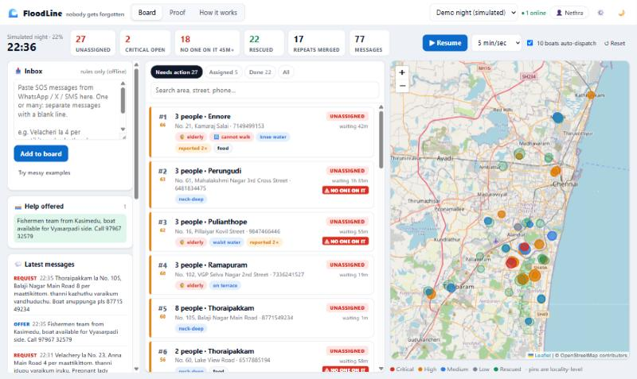
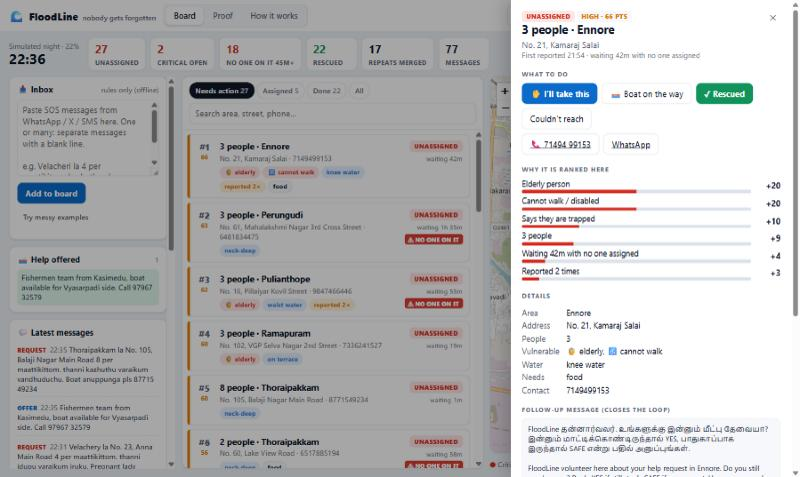
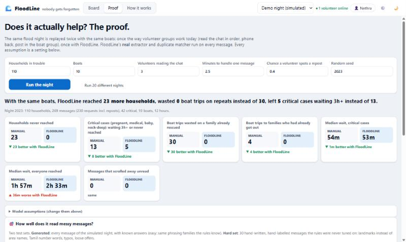
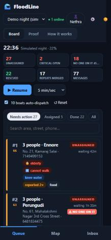

# 🌊 FloodLine — nobody gets forgotten

**One shared rescue board for the flood of messy SOS messages a disaster creates.** Paste WhatsApp / X / SMS messages in English, Tamil or Tanglish; FloodLine merges the repeats, ranks the most urgent with reasons, puts them on a map, and tracks every request until a volunteer confirms the rescue.

**▶ Live demo:** https://nethra-r368.github.io/floodline/ → press **▶ Play the night** (no key, no sign-up)



## The problem

When Chennai floods (2015, Michaung 2023, Fengal 2024, Ditwah 2025) phone lines fail and rescue requests move to WhatsApp, X and Instagram. Volunteers coordinate by reading them by hand. Three things go wrong every time:

1. **Repeats.** One family is posted ten times by relatives, so two boats go to the same house while another request waits.
2. **No closing the loop.** Nobody knows which requests were handled, so old requests keep circulating after the family is safe.
3. **Forgotten requests.** A message nobody picked up just scrolls away. Nobody notices the one from six hours ago.

## What FloodLine does

| | |
|---|---|
| 📥 **Reads anything** | Paste one message or a whole WhatsApp chat export. Rules extract area, phone, people, water level and vulnerable people **instantly and offline**. Gemini (optional) then re-reads landmarks ("near Phoenix mall" → Velachery), Tamil number words and loose phrasing. |
| 🛡 **AI guardrails** | Every AI answer is checked against the original text: a phone number that isn't in the message, an area not in the map, or an address that wasn't written is **blocked**, and the board says so. In a rescue tool an invented detail sends a boat to the wrong house. |
| 🔗 **Merges repeats** | Same phone, or same street + door number in the same area → one case, with the reason shown ("merged: same phone number"). |
| 🚨 **Ranks with reasons** | Pregnant/labour +40, medical +40, baby +25, neck-deep water +35, waiting time, number of reports… every point is listed so a volunteer can check the call. |
| ⏱ **Nobody gets forgotten** | Unclaimed 45 min → red **NO ONE ON IT**. Claimed but silent 90 min → **CHECK IN**. A "we are safe now" message → **SAYS SAFE NOW**. Still being shared after rescue → **RE-SHARED** with a ready reply to stop it. |
| 🗺 **Live map** | Cases by urgency on OpenStreetMap; rescued cases turn green. |
| 👥 **Works as a team** | Every action is an event in an append-only log. Volunteers' boards sync instantly (windows/tabs on one device today; any device with a small backend next). Export/import the log for shift handover. |
| 📞 **Close the loop** | One-tap call, WhatsApp follow-up in Tamil + English ("Reply YES if still stuck, SAFE if you are out"). |
| 📱 | Phone layout, dark mode, works offline without AI. |

| Case drawer: why it's ranked, merged reports, actions | Proof tab | Phone (dark) |
|---|---|---|
|  |  |  |

## Does it actually help? (the Proof tab)

The same simulated flood night is replayed twice with the same 10 boats: once the way volunteer groups work today, once with FloodLine. FloodLine's **real** extractor and duplicate matcher run on every message; all assumptions are settings in the app.

**Average over 20 simulated nights** (110 households, ~290 messages each, 10 boats):

| | Manual | FloodLine | FloodLine better on |
|---|---|---|---|
| Households never reached | 26.8 | **1.1** | 20 / 20 nights |
| Critical cases waiting 3h+ or never reached | 14.0 | **6.7** | 18 / 20 (worse on 2) |
| Boat trips wasted on a family already rescued | 26.7 | **0.4** | 20 / 20 |
| Boat trips to families who had already got out | 6.9 | **1.2** | 18 / 20 |
| Median wait, critical cases reached | 1h 01m | 1h 06m | worse on 14 / 20 |

The median wait is only over households that were *reached*: manual coordination leaves ~27 households unreached and they never enter its median. Serving critical cases first also means low-risk families wait longer. Both trade-offs are shown in the app, not hidden.

**How well does it read messy messages?**

| Test set | Rules (offline) | Gemini + guardrails |
|---|---|---|
| Generated night (269 messages, known answers) | 100% on every field (easy: phrasing the rules know) | — |
| **Hard set**: 30 hand-written messages the rules were never tuned on | **90.3%** overall (area 96.7%, phone 100%, water 100%, **people count 37.5%**) | run it in the Proof tab with your key |

Duplicate matching on the generated night: 230 reports → 110 cases for 110 real households (precision 100%, recall 100%).

> The night is simulated with realistic but fictional names and numbers. It shows the coordination effect under stated assumptions; it is not a field result.

## Run it

Static site, no build step, no server.

```bash
python -m http.server 8000      # open http://localhost:8000
node --test test/core.test.mjs  # 16 unit tests
```

Optional: ⚙️ → paste a free Gemini key from https://aistudio.google.com/apikey. The key stays in your browser.

## How it works

```
messages ─► splitMessages ─► extractRules (instant, offline) ─┬─► event log (append-only) ─► buildState ─► board / map / drawer
                                     │                         │        ▲  sync between volunteers
                                     └─► Gemini (optional) ─► guardAi ─┘        (BroadcastChannel, export/import)
buildState = clusterReports (merge repeats) + scoreCase (ranked reasons) + flags (stale, check-in, says-safe, re-shared)
```

All logic is pure JavaScript in `js/core/` and unit-tested; the UI only renders it. Details for judges: [docs/HOW_IT_WORKS.md](docs/HOW_IT_WORKS.md).

```
index.html, css/style.css
js/app.js        board, replay, inbox, drawer, sync      js/bench.js   Proof tab
js/map.js        Leaflet map                             js/gemini.js  Gemini call
js/core/         extract · dedupe · priority · store · prompt (AI guardrails) · sim (night + benchmark) · gazetteer · hardset · input
test/            unit tests
```

Built with JavaScript, Leaflet + OpenStreetMap, Google Gemini API, GitHub Pages. License: MIT.
